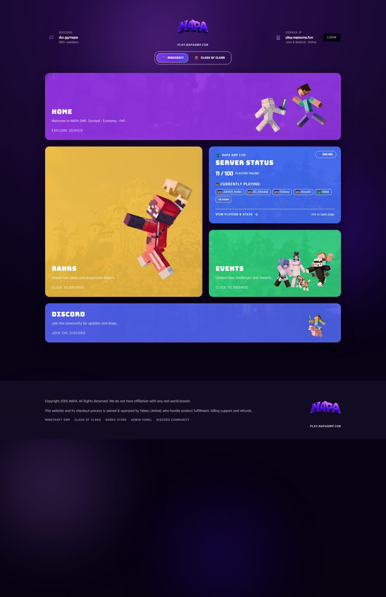
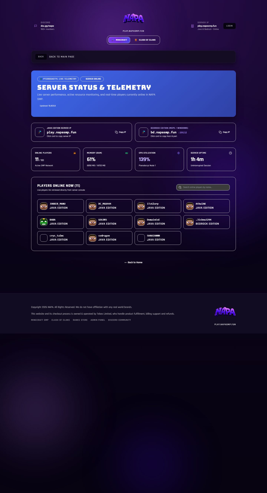
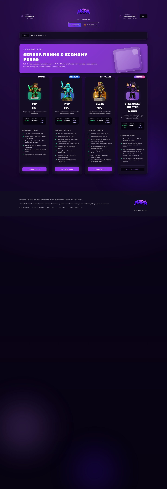
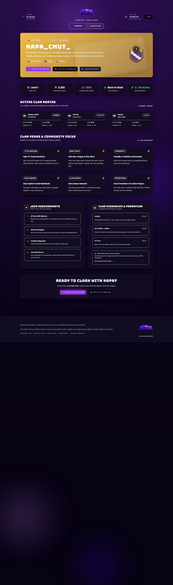
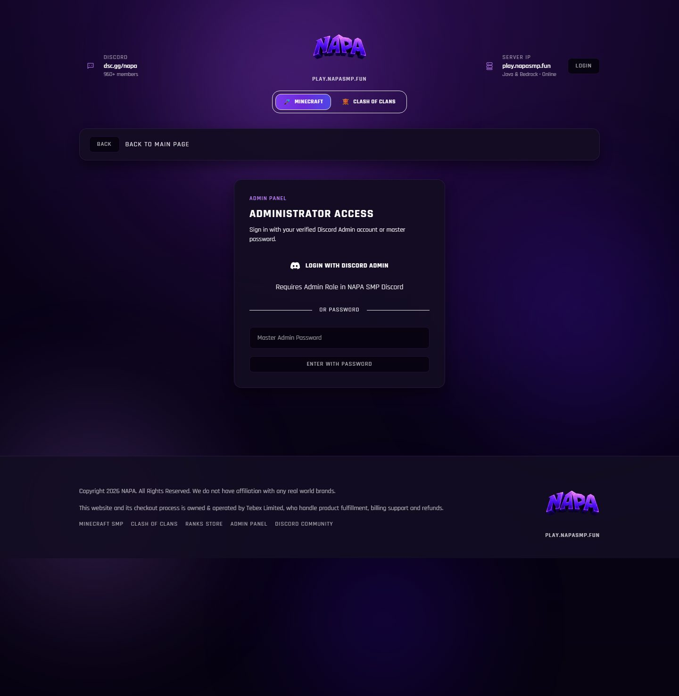

# NAPA SMP • Web Platform & Community Hub


The official web platform, store, and real-time telemetry dashboard for **NAPA SMP** — featuring dual-game support (Minecraft & Clash of Clans), live Pterodactyl server telemetry, Discord OAuth2 role-based authentication, and a protected administrative control panel.

---

## 📸 Screenshots

### 1. Storefront & Dual-Game Hub
Dynamic homepage with server quick connect, real-time player telemetry tile, Discord community card, and dual-game switcher (Minecraft & Clash of Clans).



<br />

### 2. Live Server Status & Telemetry (`/status`)
Direct Wings daemon and Pterodactyl integration providing live CPU %, RAM utilization, uptime, and real-time player head avatars with live name filtering.



<br />

### 3. Server Store & Ranks (`/ranks`)
Full storefront with 3D skin previews, feature breakdowns, and checkout modals for **VIP**, **MVP**, **ELITE**, and **CREATOR** tiers.



<br />

### 4. Clash of Clans Clan Hub (`/coc`)
Official Supercell API integration displaying real-time clan level, trophy counts, war history, Town Hall distribution, and the active clan member roster with league icons.



<br />

### 5. Admin Dashboard & Login (`/admin`)
Role-gated administration panel with instant Discord Admin OAuth2 login and local preview draft system.



---

## ✨ Key Features

- **⚡ Live Pterodactyl & Wings Telemetry**:
  - Connects directly to Wings API (`/api/servers/{uuid}`) for zero-delay hardware metrics (CPU %, RAM, uptime).
  - Fetches and caches server ping data every 10 seconds.
  - Live player list with dynamic skin avatar resolution via `mc-heads.net` and client-side player search.

- **🛡️ Discord OAuth2 & Role-Based Access Control (RBAC)**:
  - **Server Verification**: Verifies players belong to the official NAPA SMP Discord server (`1226511703483748402`).
  - **Member Verification**: Checks for the verified Member role (`1227272545963741267`).
  - **Admin Elevation**: Users with Admin roles (`1543588740935585923` or `1227507219323682858`) automatically bypass password prompts and gain instant Admin Panel access.
  - **Secure Sessions**: HMAC-SHA256 signed session cookies for tamper-proof client authorization.

- **⚔️ Dual-Game Community Hub**:
  - Top-level switcher seamlessly switches context between Minecraft SMP and the Clash of Clans clan (`#2J9GGJJPQ`).
  - Live Supercell API synchronization for clan stats, points, war log, and member league tiers.

- **📋 Resilient Fallback Clipboard System**:
  - Universal 1-click IP copy (`play.napasmp.fun`, `bd.napasmp.fun:19132`, and `#2J9GGJJPQ`).
  - Automatically falls back to `document.execCommand` when accessed over non-secure HTTP, local IP addresses, or restrictive mobile webviews (e.g. Discord in-app browser).

- **🎛️ Protected Admin Panel**:
  - Modify brand names, server IPs, Discord invite links, and announcements with live preview drafts stored in browser localStorage.

---

## 🛠️ Tech Stack

- **Framework**: Next.js 16 (App Router with Turbopack)
- **Language**: TypeScript
- **Styling**: Tailwind CSS
- **APIs**:
  - Pterodactyl Panel Client API & Wings Daemon API
  - Discord OAuth2 & Guild Member API (`v10`)
  - Supercell Clash of Clans REST API (`v1`)
  - Minotar & MC-Heads Avatar CDN

---

## 🚀 Getting Started

### Prerequisites

- **Node.js**: 18.17+ or 20+
- **npm** or **pnpm**
- Discord Developer Application credentials

### 1. Clone the repository

```bash
git clone git@github.com:xtros/NAPA-web.git
cd NAPA-web
```

### 2. Install dependencies

```bash
npm install
```

### 3. Environment Variables Configuration

Create a `.env.local` file in the root directory:

```env
# Admin Master Password & Session Secret
ADMIN_PASSWORD=your_admin_password
ADMIN_SECRET=your_random_secret_hex_key

# Clash of Clans API (https://developer.clashofclans.com)
COC_API_TOKEN=your_supercell_api_jwt_token
COC_CLAN_TAG=#2J9GGJJPQ

# Pterodactyl & Wings Server Status API
PTERODACTYL_URL=http://your-panel-ip-or-domain
PTERODACTYL_API_KEY=your_pterodactyl_client_api_key
WINGS_URL=http://your-wings-node-ip:8080
WINGS_TOKEN=your_wings_daemon_token
PTERODACTYL_SERVER_UUID=your_server_uuid

# Discord OAuth2 Authentication (https://discord.com/developers/applications)
DISCORD_CLIENT_ID=your_discord_client_id
DISCORD_CLIENT_SECRET=your_discord_client_secret
NEXT_PUBLIC_APP_URL=http://localhost:3000
```

> [!NOTE]
> Add `http://localhost:3000/api/auth/discord/callback` (and your production domain callback URL) to the **Redirects** section in your Discord Developer Portal application.

### 4. Run Development Server

```bash
npm run dev
```

Visit [http://localhost:3000](http://localhost:3000) in your browser.

---

## 📁 Project Structure

```
├── public/
│   └── assets/
│       ├── branding/        # Official NAPA SMP logos and watermarks
│       ├── ranks/           # 3D skin character models (VIP, MVP, Elite, Creator)
│       ├── screenshots/     # Showcase screenshots for documentation
│       └── tiles/           # Homepage card illustrations
├── src/
│   ├── app/
│   │   ├── (main)/          # Storefront and homepage tiles
│   │   ├── admin/           # Role-protected admin dashboard and login
│   │   ├── api/
│   │   │   ├── auth/        # Discord OAuth2 login, callback, logout, & session endpoints
│   │   │   ├── coc/         # Supercell Clash of Clans proxy
│   │   │   └── status/      # Pterodactyl & Wings telemetry endpoint
│   │   ├── coc/             # Clash of Clans clan roster & telemetry page
│   │   ├── ranks/           # Ranks catalog with feature breakdowns
│   │   └── status/          # Server status, resource graphs, & live player roster
│   ├── components/          # Reusable UI widgets, modals, custom SVG emojis
│   ├── data/
│   │   └── siteConfig.ts    # Centralized site configurations, ranks, & navigation
│   └── lib/
│       ├── adminAuth.ts     # Master password & admin token verification
│       ├── adminDraft.ts    # Admin preview draft storage
│       ├── clipboard.ts     # Universal copy-to-clipboard fallback utility
│       └── discordAuth.ts   # Discord OAuth2 helpers, role IDs, & session verification
```

---

## 📄 License

This project is open-source under the [MIT License](LICENSE).
